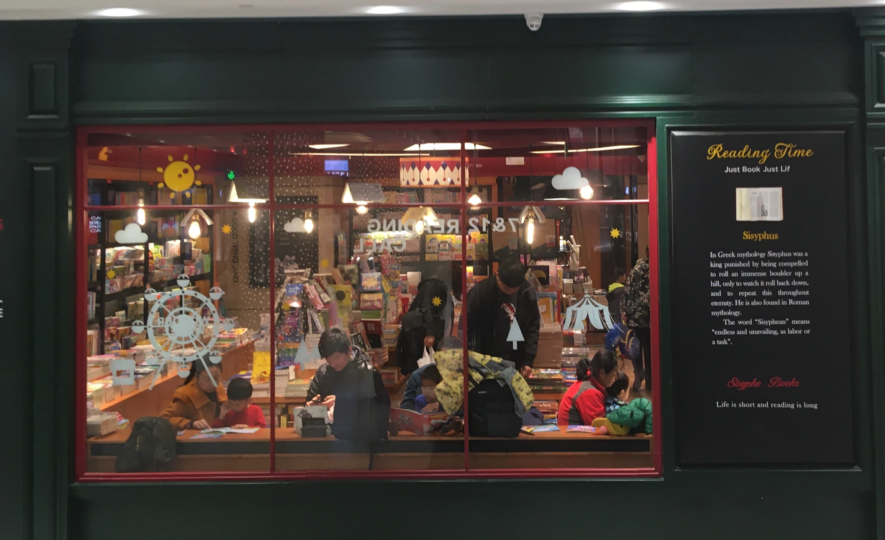

```html
<!DOCTYPE html>
<html lang="es">
<head>
    <meta charset="UTF-8">
    <meta name="viewport" content="width=device-width, initial-scale=1.0">
    <title>Galeria visual de viajes</title>
</head>
<body>
    <h1>Galeria visual de viajes</h1>
    <p>Esta galeria presenta algunos lugares interesantes para viajar y conocer.</p>
    <h2>Indice</h2>
    <ul>
        <li><a href="#kas">Kas</a></li>
        <li><a href="#mw">Morfelden-Walldorf</a></li>
        <li><a href="#valencia">Valencia</a></li>
        <li><a href="#kioto">Kioto</a></li>
        <li><a href="#pekin">Pekin</a></li>
    </ul>   
       <h2 id="kas">Kas</h2>
        <p>
        Kas es una pequena ciudad de Turquia, situada en la costa del mar Mediterraneo.
        Tiene un puerto con yates, lugares interesantes para bucear y un antiguo teatro.
        </p>
        
        <ul>
            <li>Tiene un antiguo teatro</li>
            <li>Es un lugar popular para bucear</li>
            <li>Tiene un puerto con muchos barcos y yates</li>
        </ul>
        <h2 id="mw">Morfelden-Walldorf</h2>
        <p>
        Morfelden-Walldorf es una pequena ciudad alemana situada cerca de la gran y ruidosa Frankfurt.
        La ciudad esta formada por dos antiguos municipios, Morfelden y Walldorf, que se unieron en 1977.
        </p>
        <a href="https://hessen-forst.de/freizeit/wildpark-alte-fasanerie-hanau">
            
        </a>
        <ul>
            <li>Esta cerca de Frankfurt</li>
            <li>Se formo con la union de Morfelden y Walldorf</li>
            <li>Es una ciudad pequena y tranquilla</li>
        </ul>
        <h2 id="valencia">Valencia</h2>
        <p>
        Valencia es una preciosa ciudad espanola situada en la costa del mar Mediterraneo. 
        Aqui se combinan un clima agradable, una arquitectura preciosa, una cultura interesante y gente maravillosa.
        </p>    
        
        <ul>
            <li>Esta ciudad esta en la costa del mar Mediterraneo</li>
            <li>Tiene un centro historico con muchos edificios antiguos</li>
            <li>La Ciudad de las Artes y las Ciencias es uno de sus lugares mas famosos</li>
        </ul>
        <h2 id="kioto">Kioto</h2>
        <p>
        Kioto fue la capital de Japon durante muchos siglos, antes de que la capital se trasladara a Tokio.
        La ciudad conserva una gran parte de su arquitectura y paisaje historicos.
        Existen normas especiales para limitar la altura y el diseno de los edificios y proteger el aspecto tradicional de la ciudad.
        Kioto tiene tambien muchos templos budistas y santuarios.
        </p> 
        
        <ul>
            <li>Fue la capital de Japon durante muchos siglos</li>
            <li>Tiene muchos templos budistas y santuarios</li>
            <li>Conserva muchos edificios y lugares historicos</li>
        </ul>
        <h2 id="pekin">Pekin</h2>
        <p>
        Pekin es una antigua ciudad china con aproximadamente 21,8 millones de habitantes.
         En esta ciudad se combinan la cultura tradicional china, la historia de las antiguas dinastias y la vida de una gran ciudad moderna.
        </p>
         
        <ul>
            <li>Es la capital de China</li>
            <li>Tiene aproximadamente 21,8 millones de habitantes</li>
            <li>Tiene muchos lugares historicos y culturales</li>
        </ul>       
</body>
</html>
```
